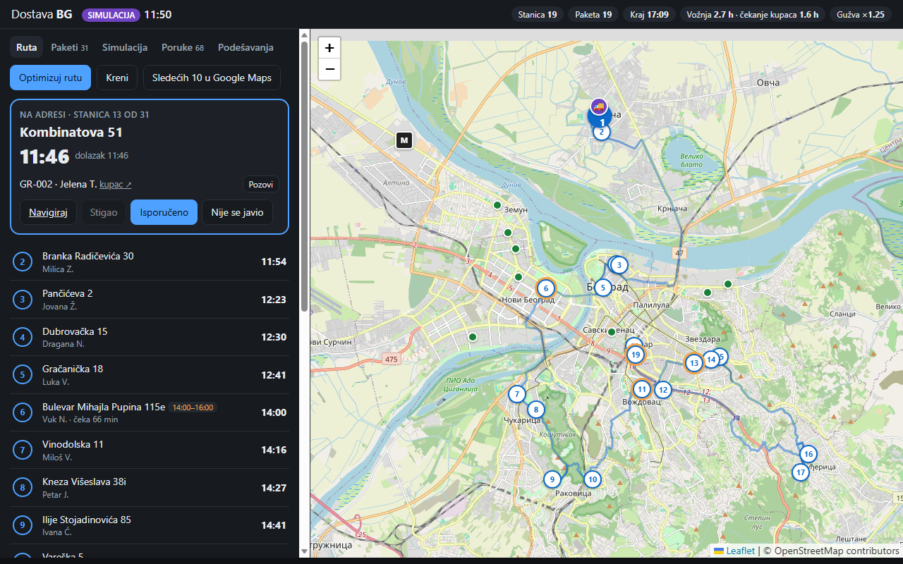

# Dostava BG

Route planning for parcel couriers in **Belgrade and its surroundings**. The courier scans the day's packages. The app resolves each one to a **building** and plans a route that respects customer time windows and the ~5 minutes a customer needs to come down. ETAs then stay live while the courier drives.

> MVP / test bench: Python backend, web app, Expo (React Native) app. Not affiliated with any courier company.



## What it does

1. **Scan → building.** Packages come in from a QR label (phone camera), a CSV file or manual entry. Addresses are matched against a local index of about 280,000 Belgrade addresses built from OpenStreetMap, which carries the RGZ house-number import. The matcher handles:
   - Cyrillic, missing diacritics (`Dorda Stanojevica`) and abbreviations (`Bul.`, `ul.`)
   - apartment suffixes (`10/25, stan 12`) and house-number letters (`31 A`, `10ž`)
   - old and colloquial street names (`Bulevar AVNOJ-a` → *Bulevar Zorana Đinđića*, `Knez Mihailova` → *Kneza Mihaila*, `27. marta` → *Dvadeset sedmog marta*)
   - the same street name in several municipalities

   Each match gets a confidence: `ok`, `approx` (check the pin) or `none` (set the pin by hand).
2. **Stops, not packages.** The courier calls and the customer comes out, so apartment numbers are not needed. Packages for the same building with compatible windows become one stop with one service time (5 min by default).
3. **Plan.** Single-courier VRPTW on OR-Tools: open route, customer windows (wait if early, soft if late) and a soft shift end. Travel times come from OSRM, multiplied by a Belgrade time-of-day profile, and the solver runs twice to account for time-dependent travel.
4. **Live.** ETAs are recomputed from where the courier is now: phone GPS, or the built-in simulator.
   - The speed observed on the current leg feeds a decaying slowdown factor for the next legs.
   - The rest of the route is re-optimized when a customer doesn't come out (retried 60 min later), a package is added mid-day, or a window is about to be missed.
   - Windows already promised to customers stay soft constraints, so nobody gets reshuffled by hours.
5. **Customers.** Each customer gets a promised window: wide for stops late in the day, narrowed about 1.5 h ahead. They get an update only when the ETA leaves that window, plus *"izađite ispred zgrade"* about 5 minutes before arrival. Every package has a tracking page at `/t/<code>`. The MVP logs these messages instead of sending SMS/Viber.
6. **Navigation.** A map shows numbered stops on real road geometry, with a Google Maps link for the next stop (or the next 10).

## Honest limitations

- **Traffic is estimated, not live.** OSRM knows the road network but not traffic. On top of it sit a hand-tuned rush-hour profile (shown as an estimate in the UI) and the slowdown measured from the courier's own GPS. A live provider (TomTom / HERE / Google Routes) can be added behind the same `table()` / `route_legs()` interface in `backend/app/routing.py`.
- The public **OSRM demo server** is for testing only: about 1 request/s and at most 100×100 cells per table. Requests are chunked and cached. Run OSRM locally for anything more (see below).
- One courier, one day, state in a JSON file, no authentication.
- **The 5 minutes per stop dominate the day.** 60 stops means 5 hours of waiting for customers. The test set (100 packages → 61 stops) fills a 08:00–20:00 shift. Notifying the next customer before arrival is what makes this workable.

## Run it

### Backend + web app

```bash
scripts/setup-backend.sh   # venv + deps, downloads serbia-latest.osm.pbf (~240 MB, Geofabrik),
                           # builds the address index (~30 s), generates test data
scripts/run-backend.sh     # http://localhost:8000
```

Open <http://localhost:8000> → **Paketi** → *Učitaj test skup* → **Simulacija** → *Pokreni* → *▶ Auto*.
This plays a whole day in about a minute, with random traffic jams and customers who don't come out.

### Test input (QR labels)

- <http://localhost:8000/test-data/rejon-nbg-zemun-100-etikete.html>: 100 packages for one courier's area (Novi Beograd, Zemun, Bežanijska kosa, Ledine, Surčin). It includes several packages per building, 18 time windows, Cyrillic / no-diacritics / abbreviated / apartment-suffix addresses, a non-existent street and a non-existent house number.
- <http://localhost:8000/test-data/ceo-grad-30-etikete.html>: 30 packages across the city (Pančevo, Borča, Kaluđerica, Rakovica, Dobanovci, …).

Use the *Jedan po jedan* mode to show one big QR code at a time and scan it from the screen with the phone. The same data is available as CSV in `test-data/`. Addresses are real buildings from OSM. Names are made up, and phone numbers are `TEST-xxxx`, so the *Pozovi* button never dials anyone.

QR payload: `{"v":1,"id":"PK-001","ime":"…","tel":"…","adresa":"Ulica 12","mesto":"Zemun","od":"10:00","do":"12:00"}` (or `id|ime|tel|adresa|mesto|od|do`).

### Expo app (Android / iOS via Expo Go)

```bash
cd mobile
npm install
npx expo start             # scan the terminal QR code with Expo Go (SDK 58)
```

The app has four tabs: *Skeniraj* (camera QR scanning), *Ruta* (next stop: call, navigate, delivered, didn't come out), *Mapa* (stops, road geometry, courier; long-press to place a missing pin) and *Podešavanja* (server URL, GPS on/off, simulator, test data).

It assumes the backend is on the same machine as Metro (`http://<metro-host>:8000`). Change the address in *Podešavanja* or set `EXPO_PUBLIC_API_URL`.

#### Getting the phone to reach the PC

| Setup | What to do |
|---|---|
| Linux / macOS, same Wi-Fi | Nothing special. |
| **WSL2** (NAT networking), same Wi-Fi | On Windows, run `scripts/wsl-expose.ps1` in an **admin** PowerShell (port forwarding 8000/8081 + firewall rule for private networks). Then run `scripts/expo-lan.sh`. Run it again after a reboot, because the WSL IP changes. |
| Different networks / restrictive Wi-Fi | `npx expo start --tunnel` for Metro. For the backend, use any HTTPS tunnel (e.g. `cloudflared tunnel --url http://localhost:8000`) and put its URL in *Podešavanja*. This makes your local backend reachable from the internet while it runs. HTTPS also enables the camera in the phone's browser for the web app. |

### Local OSRM (recommended beyond testing)

These are the standard OSRM Docker steps, not yet run in this project:

```bash
cd backend/data/osm
docker run -t -v "$PWD:/data" ghcr.io/project-osrm/osrm-backend osrm-extract -p /opt/car.lua /data/serbia-latest.osm.pbf
docker run -t -v "$PWD:/data" ghcr.io/project-osrm/osrm-backend osrm-partition /data/serbia-latest.osrm
docker run -t -v "$PWD:/data" ghcr.io/project-osrm/osrm-backend osrm-customize /data/serbia-latest.osrm
docker run -t -p 5000:5000 -v "$PWD:/data" ghcr.io/project-osrm/osrm-backend osrm-routed --algorithm mld /data/serbia-latest.osrm
OSRM_URL=http://localhost:5000 scripts/run-backend.sh
```

## How it fits together

```
 QR / CSV / manual ──► geocode.py ──► engine.py ──────────────► API (FastAPI, main.py)
                       OSM index      stops, plan, live ETAs,      ├─ web/ (Leaflet)
                       (SQLite)       promises, notifications,     ├─ mobile/ (Expo)
                                      simulator                    └─ /t/<code> customer page
                                         │
                       routing.py ◄──────┤ OSRM table + road geometry, rush-hour profile
                       optimizer.py ◄────┘ OR-Tools VRPTW (2-pass, time-dependent)
```

| Endpoint | |
|---|---|
| `GET /api/state` | everything the clients draw: route with ETAs, packages, courier, notifications |
| `GET /api/geometry` | road geometry of the remaining route; refetch when `geom_version` changes |
| `POST /api/packages` | `{"qr": "..."}` or package fields |
| `POST /api/packages/import` | `{"csv": "..."}` |
| `PUT /api/packages/{id}/location` | manual pin |
| `POST /api/plan`, `POST /api/day/start` | optimize, courier leaves the depot |
| `POST /api/courier/position` | GPS from the phone |
| `POST /api/stops/{id}/arrived\|delivered\|failed` | courier actions |
| `POST /api/sim/start\|step\|stop` | simulated clock |
| `GET /api/geocode?q=&place=` | geocoder playground |

## Tests

```bash
cd backend && .venv/bin/python -m pytest -q     # text normalisation, geocoder on the real index,
                                                # solver, whole simulated days
cd mobile && npx tsc --noEmit && npx expo lint
```

## Ideas for next steps

- Live traffic provider behind the routing interface.
- Learn the Belgrade profile from the courier's own logged trips (actual vs. predicted by hour and area).
- Read real courier labels (printed address, no QR) with a vision model.
- Real SMS/Viber messages; let the customer pick a slot from the tracking link.
- Several couriers (OR-Tools handles multiple vehicles).

## Data

Addresses, street names and map tiles: © [OpenStreetMap](https://www.openstreetmap.org/copyright) contributors, ODbL. The extract comes from [Geofabrik](https://download.geofabrik.de/europe/serbia.html). The OSM tile server and OSRM demo server are used under their fair-use policies for development only.
